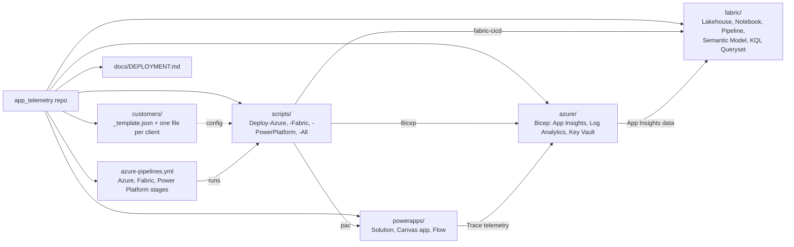

# Deployment guide

One repo, three components, deployed per customer tenant from a config file.

| Component | Folder | Script | Mechanism |
|---|---|---|---|
| Azure (App Insights, Log Analytics, Key Vault) | `azure/infra` | `scripts/Deploy-Azure.ps1` | Bicep, `az deployment group create` |
| Fabric (lakehouse, notebook, pipeline, model, ...) | `fabric/` | `scripts/Deploy-Fabric.ps1` | `fabric-cicd`, dev IDs rewritten per customer |
| Power Platform (solution, Canvas app, flow) | `powerapps/` | `scripts/Deploy-PowerPlatform.ps1` | `pac solution pack/import`, App Insights key patched in |

`scripts/Deploy-All.ps1 -Customer <code>` runs all three. `azure-pipelines.yml` runs the same scripts as stages.

## Structure



## Per customer

1. Copy `customers/_template.json` to `customers/<code>.json` and fill it in. Customer files are committed to the repo (IDs only, no secrets); the pipeline fails with "Customer config not found" if `customers/<code>.json` is not pushed.
2. Prerequisites in the customer tenant:
   - Azure: subscription, and rights to create the resource group and role assignments.
   - Fabric: workspace created and capacity-assigned; deploying identity is a workspace member; the tenant setting allowing service principals to use Fabric APIs is enabled.
   - Power Platform: target environment; an app registration added as an application user with System Administrator.
3. Secrets are never stored in the repo. `PP_CLIENT_SECRET` comes from the environment (ADO secret variable).

## Manual run

```powershell
az login --tenant <tenantId>
./scripts/Deploy-Azure.ps1 -Customer contoso -WhatIf   # preview
./scripts/Deploy-All.ps1  -Customer contoso            # all components
```

Use `-PackOnly` on `Deploy-PowerPlatform.ps1` to produce the solution zip without importing.

## Azure DevOps

Create a pipeline from `azure-pipelines.yml`, then per customer create:
- a service connection into the customer tenant (workload identity federation preferred),
- a variable group `apptelem-<code>` containing secret `PP_CLIENT_SECRET`,
- an Environment `apptelem-<code>` (add approvals there).

Run with the `customer` and `serviceConnection` parameters. Azure outputs are passed to later stages as the `azure-outputs` pipeline artifact.

### Fabric access for the deploying service principal

The Fabric stage runs as the identity behind the chosen service connection. It must be allowed into the customer's Fabric workspace, otherwise the stage fails with `The caller does not have sufficient permissions to access the requested resource` (a `GET` on `api.powerbi.com/v1/workspaces/<id>`).

1. Find the identity: Azure DevOps → Project settings → Service connections → the connection → **Manage App registration** (or the managed identity / workload identity federation details). Copy the client (application) ID. It must be in the customer tenant (`tenantId` in the customer JSON).
2. Fabric admin portal → Tenant settings → enable **Service principals can use Fabric APIs**. Scope it to a security group containing that app. Changes can take about 15 minutes to apply.
3. In the Fabric workspace → Manage access → add the app (or the security group) as **Member** or **Admin**. Contributor is not enough.
4. Check `fabric.workspaceId` in `customers/<code>.json` is the correct workspace, then rerun the pipeline.

## After deployment: API key, secret and first ingest

The deployment creates the Key Vault but not the secret. The Fabric notebook reads the secret `appinsights-query-api-key` at runtime, and `deploy_fabric.py` already points the deployed notebook at the customer's vault (`keyVaultUrl` from `azure-outputs.json`).

**Azure side**

1. Find the vault name: the `keyVaultName` value in the `azure-outputs` artifact (`out/<code>/azure-outputs.json`), or the log line `Azure deployment complete. Key Vault: …`.
2. Create the key: Azure portal → the customer's Application Insights → Configure → **API Access** → Create API key. Tick only **Read telemetry**. Copy it immediately; it is shown once.
3. Give yourself write access to the vault: **Key Vault Secrets Officer** on the vault (the vault uses RBAC).
4. Store the secret:
   ```powershell
   az keyvault secret set --vault-name <keyVaultName> --name appinsights-query-api-key --value "<api key>"
   ```
   Or portal → Key Vault → Secrets → Generate/Import, name `appinsights-query-api-key`.
5. Grant the reader: the identity that runs the notebook in Fabric needs **Key Vault Secrets User**. Add its object ID to `azure.secretReaderPrincipalIds` in `customers/<code>.json` and rerun the Azure stage (or assign the role in the portal).

**Fabric side**

1. Open the new workspace and run `app_telemetry_ingest_pipeline` (or the notebook directly). Schedule it afterwards.
2. Check that `Requests` and `RequestsCustomDimensions` in `app_telemtry_lh_bronze` contain rows. Failures are visible in the run output.
3. Open the semantic model and refresh/check it against the Lakehouse.

**Troubleshooting**

- `403` from Key Vault: the run-as identity lacks Secrets User, or role assignment hasn't propagated (wait a few minutes).
- `401`/`403` from the App Insights API: wrong or non-"Read telemetry" key, or the key belongs to a different App Insights resource.
- Empty tables with a green run: no telemetry in the load window; generate traffic (e.g. the demo API) and rerun.
- Running one stage in isolation needs prior Azure outputs; the pipeline falls back to re-reading them with `Deploy-Azure.ps1 -OutputsOnly`.

See also [APP_INSIGHTS_FABRIC_SETUP.md](../azure/APP_INSIGHTS_FABRIC_SETUP.md).

## Known manual / unverified items

- Not yet run end to end; `pac` YAML-format packing, managed packaging and `fabric-cicd` parameter behaviour need a first test run.
- Dataflows are excluded from the default Fabric item types (per-tenant connection bindings); set up manually.
- Power Platform connection references (e.g. MSN Weather) and flow wiring need customer connection IDs.
- Dataverse telemetry export to Application Insights is configured manually in the Power Platform admin center.
- Application Insights API keys were announced as retired (31 Mar 2026). The ingest notebook uses an API key; plan a move to Entra auth (service principal with Monitoring Reader).
