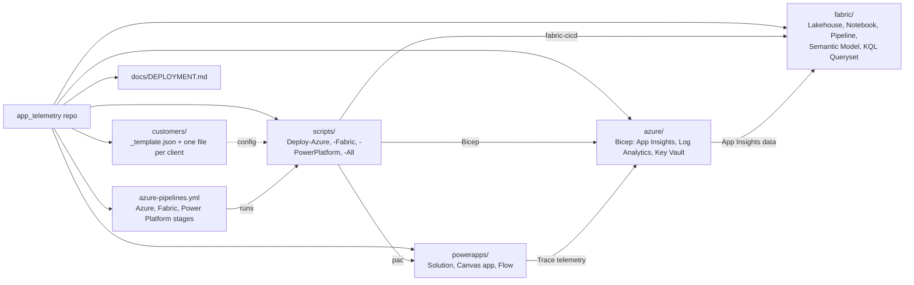

# Deployment guide

One repo, three components, deployed per customer tenant from a config file.

| Component | Folder | Script | Mechanism |
|---|---|---|---|
| Azure (App Insights, Log Analytics, Key Vault; optional Event Hub + data export) | `azure/infra` | `scripts/Deploy-Azure.ps1` | Bicep, `az deployment group create` |
| Fabric (lakehouse, notebook, pipeline, model, ...) | `fabric/` | `scripts/Deploy-Fabric.ps1` | `fabric-cicd`, dev IDs rewritten per customer |
| Power Platform (solution, Canvas app, flow) | `powerapps/` | `scripts/Deploy-PowerPlatform.ps1` | committed exported zip, App Insights key patched in, `pac solution import` |

`scripts/Deploy-All.ps1 -Customer <code>` runs all three. `azure-pipelines.yml` runs the same scripts as stages.

## Order of operations

The Key Vault is created by the Azure stage, so the Power Platform secret can only be stored after the first Azure run.

1. Create `customers/<code>.json` from `customers/_template.json` and push it.
2. In the customer tenant, create the Power Platform app registration, add it as an application user with System Administrator, and create a client secret.
3. Create the Azure DevOps service connection and a variable group containing `Service_Connection`.
4. Run the Azure stage (creates App Insights, Log Analytics and the Key Vault).
5. Store the PP client secret **Value** in the vault as `pp-client-secret`, and grant the service connection's enterprise-application object ID "Key Vault Secrets User" on the vault.
6. Run the Fabric stage with **fabricBootstrap = true** for a new workspace. This publishes infrastructure without shortcuts, semantic models, or reports. Power Platform can deploy independently.
7. Complete the [real-time hot-path setup](./REALTIME_HOTPATH.md): run the KQL setup, configure/publish the Eventstream, and wait for the first OneLake-mirrored Delta files.
8. Enable `fabric.realtime.lakehouseShortcuts` with `AppRequestsRT` included, then run the Fabric stage with **fabricBootstrap = false**. Shortcuts must publish successfully before the semantic model is imported.

See "Identities and secrets" below for what each identity needs.

For private Event Hub connectivity, first enable the Fabric workspace identity and
set `azure.realtime.privateNetworking` with its service-principal object ID and
the Fabric region. The Azure stage provisions the delegated gateway subnet, separate
private endpoint subnet, DNS, and VNet-scoped Network Contributor assignment. It
registers `Microsoft.MessagingConnectors` if needed. Create the streaming VNet
gateway and its Event Hubs **Extended features** connection in Fabric afterwards;
these are not created by Bicep. Contoso's next deployment targets
the existing `rg-apptelem-contoso`, with the configured Azure resource and networking
region set to Central US to match its Fabric capacity. This does not relocate
existing UK South resources. Redeployment requires resolving same-name resource
region conflicts. The deployment script reuses the existing resource group without
changing its metadata location.
Update telemetry producers and the Fabric Event Hub connection to the new
deployment's endpoints before switching ingestion. The Event Hub retains a trusted Microsoft services
exception for Log Analytics export while denying general public client traffic.
See [Step 1a](./REALTIME_HOTPATH.md#step-1a-private-event-hub-connectivity-and-streaming-vnet-gateway).

## Structure



## Per customer

1. Copy `customers/_template.json` to `customers/<code>.json` and fill it in. Customer files are committed to the repo (IDs only, no secrets); the pipeline fails with "Customer config not found" if `customers/<code>.json` is not pushed.
2. Prerequisites in the customer tenant:
   - Azure: subscription, and rights to create the resource group and role assignments.
   - Fabric: workspace created and capacity-assigned; deploying identity is a workspace member; the tenant setting allowing service principals to use Fabric APIs is enabled.
   - Power Platform: target environment; an app registration added as an application user with System Administrator.
3. Secrets are never stored in the repo. The PP client secret is read at run time from the customer Key Vault (secret `pp-client-secret`).

## Manual run

```powershell
az login --tenant <tenantId>
./scripts/Deploy-Azure.ps1 -Customer contoso -WhatIf   # preview
./scripts/Deploy-All.ps1  -Customer contoso            # all components
```

Use `-PackOnly` on `Deploy-PowerPlatform.ps1` to produce the solution zip without importing.

## Identities and secrets

Four different identities are involved. Do not mix them up.

| # | Identity | Auth | Used by / where | Needs | Secret lives |
|---|----------|------|-----------------|-------|--------------|
| 1 | **Service connection SPN** (Azure DevOps) | Federated, no secret | `az login` in every pipeline stage: deploys Bicep, runs `deploy_fabric.py`, and **reads `pp-client-secret` from Key Vault** in the PP stage | Contributor on the customer resource group; **Key Vault Secrets User** on the vault; member of the Fabric workspace + tenant setting "Service principals can use Fabric APIs". No Power Platform access | None |
| 2 | **Power Platform app registration** (`powerPlatform.applicationId`) | Client secret | `pac auth create` in `Deploy-PowerPlatform.ps1` to import the solution | **System Administrator** application user in the Dataverse environment. No Azure/Key Vault access | Client secret **Value** stored in Key Vault as `pp-client-secret` |
| 3 | **Fabric notebook run-as identity** | User/SPN that runs the notebook | `app_telemetry_ingest` notebook reads `appinsights-query-api-key` from Key Vault | **Key Vault Secrets User** (via `azure.secretReaderPrincipalIds` or portal) | n/a |
| 4 | **Human deployer** | Your login | One-off setup | Owner/User Access Administrator (assign roles) and a Key Vault secrets-write role (create secrets) | n/a |

Run flow for the Power Platform stage: pipeline logs in as **#1** → #1 reads the secret `pp-client-secret` from Key Vault → the secret is used to sign in as **#2** with `pac` → #2 imports the solution.

Gotchas:
- #1 and #2 are separate app registrations. The Key Vault role goes to #1 (the one behind the service connection), not #2.
- Role assignments need the **enterprise application (service principal) object ID**, not the app registration's object ID. The Key Vault 403 in the pipeline log prints the correct one as `oid=`.
- Key Vault stores the secret **Value**, never the Secret ID.
- The #2 secret expires; set a rotation reminder and update the vault secret.

## Azure DevOps

Create a pipeline from `azure-pipelines.yml`, then per customer create:
- a service connection into the customer tenant (workload identity federation preferred),
- Key Vault secret `pp-client-secret` (the service connection's SPN, identity #1 above, needs **Key Vault Secrets User** on the vault; the PP app registration does not),
- an Environment `apptelem-<code>` (add approvals there).

Run with the `customer` and `serviceConnection` parameters. Azure outputs are passed to later stages as the `azure-outputs` pipeline artifact.

For a new Fabric workspace, select `fabricBootstrap = true` first, then `false` after
the Eventhouse's mirrored tables are ready. Locally use
`Deploy-Fabric.ps1 -Customer <code> -Bootstrap` or `Deploy-All.ps1 -Customer <code> -FabricBootstrap`.
Bootstrap does not execute any notebook or pipeline. Normal deployment publishes
infrastructure and shortcuts first, then semantic models and reports in a separate pass.

### Fabric access for the deploying service principal

The Fabric stage runs as the identity behind the chosen service connection. It must be allowed into the customer's Fabric workspace, otherwise the stage fails with `The caller does not have sufficient permissions to access the requested resource` (a `GET` on `api.powerbi.com/v1/workspaces/<id>`).

1. Find the identity: Azure DevOps → Project settings → Service connections → the connection → **Manage App registration** (or the managed identity / workload identity federation details). Copy the client (application) ID. It must be in the customer tenant (`tenantId` in the customer JSON).
2. Fabric admin portal → Tenant settings → enable **Service principals can use Fabric APIs**. Scope it to a security group containing that app. Changes can take about 15 minutes to apply.
3. In the Fabric workspace → Manage access → add the app (or the security group) as **Member** or **Admin**. Contributor is not enough.
4. Check `fabric.workspaceId` in `customers/<code>.json` is the correct workspace, then rerun the pipeline.

### Power Platform app registration

The Power Platform stage authenticates with `pac auth create` using a client secret. This is identity #2 in [Identities and secrets](#identities-and-secrets), different from the Azure/Fabric service connection (#1, federated, no secret). The pipeline fetches this secret from Key Vault using #1.

1. Entra ID → App registrations → **New registration**. Single tenant, no redirect URI. Copy the **Application (client) ID** and the tenant ID.
2. Open **that same app registration** (the one whose client ID you copied in step 1) → Certificates & secrets → **New client secret**. A secret only works for the app it was created on, so it must not come from the Azure/Fabric service connection's app or any other app. Copy the **Value** (not the Secret ID) immediately; it is shown only once. Store it in Key Vault: `az keyvault secret set --vault-name <kv> --name pp-client-secret --value "<secret>"` (override the name with `powerPlatform.clientSecretName`). The pipeline reads it at run time; nothing is stored in Azure DevOps. The secret expires, so set a rotation reminder.
   - `AADSTS7000215: Invalid client secret` means the secret does not belong to `powerPlatform.applicationId`, is the Secret ID rather than the Value, has expired, or the Key Vault secret holds the wrong value.
3. No API permissions are needed.
4. Power Platform admin center → Environments → the target environment → Settings → Users + permissions → **Application users** → New app user. Select the app, choose the root business unit, and assign a role that can import solutions (System Administrator, or a custom role). The environment must be Dataverse-enabled.
5. In `customers/<code>.json` set `powerPlatform.applicationId` to the client ID and `powerPlatform.environmentUrl` to the environment URL.
   - The zip in `powerapps/solutionpackage/` is imported as exported. Managed vs unmanaged is fixed at export time; a mismatch with what is installed fails, and you must delete the solution in the environment before switching.
6. Optional check:
   ```powershell
   pac auth create --name test --applicationId <client-id> --clientSecret <secret> --tenant <tenant-id> --environment <environment-url>
   pac org who
   ```

### Connection references

`powerPlatform.connectionReferences` entries with an empty or `REPLACE_*` `connectionId` are skipped (with a warning), leaving the reference unbound. To bind one, create the connection in the target environment and put its ID (from the maker-portal connection URL, or `pac connection list`) in the customer JSON.

## After deployment: API key, secret and first ingest

The deployment creates the Key Vault but not the secret. The Fabric notebook reads the secret `appinsights-query-api-key` at runtime, and `deploy_fabric.py` already points the deployed notebook at the customer's vault (`keyVaultUrl` from `azure-outputs.json`).

**Azure side**

1. Find the vault name: the `keyVaultName` value in the `azure-outputs` artifact (`out/<code>/azure-outputs.json`), or the log line `Azure deployment complete. Key Vault: …`.
2. Create the key: Azure portal → the customer's Application Insights → Configure → **API Access** → Create API key. Tick only **Read telemetry**. Copy it immediately; it is shown once.
3. Give yourself write access to the vault: **Key Vault Secrets Officer** on the vault (the vault uses RBAC).
4. Store the secret:
   ```powershell
   az keyvault secret set --vault-name <keyVaultName> --name appinsights-query-api-key --value "<api key>"
   ```
   Or portal → Key Vault → Secrets → Generate/Import, name `appinsights-query-api-key`.
5. Grant the reader: the identity that runs the notebook in Fabric needs **Key Vault Secrets User**. Add its object ID to `azure.secretReaderPrincipalIds` in `customers/<code>.json` and rerun the Azure stage (or assign the role in the portal).

**Fabric side**

1. Follow [REALTIME_HOTPATH.md](./REALTIME_HOTPATH.md) to initialize the KQL tables and publish the Eventstream.
2. Verify OneLake availability has written Delta files for `AppRequestsRT`, then complete the non-bootstrap deployment.
3. In `app_telemtry_lh_bronze`, check the `dbo.AppRequestsRT` OneLake shortcut. Open `app_telemetry_model` and check its `Requests` table against that shortcut.

The model no longer reads the notebook's `Requests` table. Legacy notebook/dataflow
ingestion remains optional and is not a prerequisite for this zero-ETL reporting path.
The hot-path model retains only the 14 columns available in `AppRequestsRT`; `success`
is now boolean and `duration` is in milliseconds. Reports using removed legacy columns
must be updated; see the mapping in [REALTIME_HOTPATH.md](./REALTIME_HOTPATH.md#step-6-direct-lake-reporting).

The Fabric deployment also publishes the checked-in Dataflow Gen2 items, including
`dataflow_weather_flow`, which writes the 24-hour weather-flow trace summary to the
`weather_flow_runs` Lakehouse table. Their Application Insights
App ID, Lakehouse ID, and workspace ID are parameterized for the target environment. After
deployment, configure each dataflow's Web source connection and Lakehouse destination with
the target workspace's connections and credentials, then open and save the dataflow to publish
the changes before refreshing it. Fabric connection IDs and credentials are workspace-specific
and are not copied from the development workspace. The target tenant is determined by the
Fabric workspace and the identity used to deploy; it is not a value in the dataflow definition.
These dataflows and the notebook pipeline remain alternate batch paths; neither feeds
the checked-in hot-path semantic model.

**Troubleshooting**

- `403` from Key Vault: the run-as identity lacks Secrets User, or role assignment hasn't propagated (wait a few minutes).
- `401`/`403` from the App Insights API: wrong or non-"Read telemetry" key, or the key belongs to a different App Insights resource.
- Empty tables with a green run: no telemetry in the load window; generate traffic (e.g. the demo API) and rerun.
- Running one stage in isolation needs prior Azure outputs; the pipeline falls back to re-reading them with `Deploy-Azure.ps1 -OutputsOnly`.
- `Dataset_Import_FailedToImportDataset` with a `null` message: the service did not supply a useful cause. For a new workspace, check that `dbo.AppRequestsRT` exists through the shortcut, its mirrored Delta schema is readable by the deploying identity, and the model's staged OneLake IDs point to the target. Use `fabricBootstrap = true` before initializing the hot path; a successful Lakehouse/SQL endpoint publish alone does not create the source table.

See also [APP_INSIGHTS_FABRIC_SETUP.md](../azure/APP_INSIGHTS_FABRIC_SETUP.md).

## Known manual / unverified items

- The optional real-time Azure resources (`azure.realtime.enabled`) are the Event Hub and Log Analytics data export. A Git-synced Eventstream and OneLake shortcuts can be promoted by the Fabric stage; the target connection, KQL setup script, and Activator rules still require setup. See [REALTIME_HOTPATH.md](./REALTIME_HOTPATH.md).
- Not yet run end to end; the Power Platform solution import and `fabric-cicd` parameter behaviour need a first test run.
- Dataflow connections and credentials must be bound in each target workspace after deployment.
- Power Platform connection references (e.g. MSN Weather) and flow wiring need customer connection IDs.
- Dataverse telemetry export to Application Insights is configured manually in the Power Platform admin center.
- Application Insights API keys were announced as retired (31 Mar 2026). The ingest notebook uses an API key; plan a move to Entra auth (service principal with Monitoring Reader).
