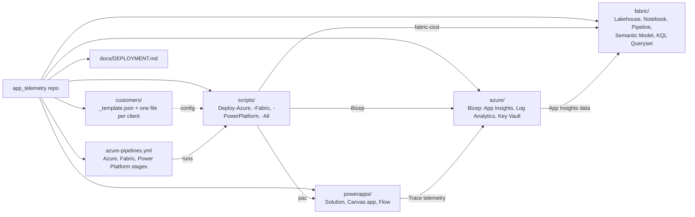

# Deployment guide

One repo, three components, deployed per customer tenant from a config file.

| Component | Folder | Script | Mechanism |
|---|---|---|---|
| Azure (App Insights, Log Analytics, Key Vault) | `azure/infra` | `scripts/Deploy-Azure.ps1` | Bicep, `az deployment group create` |
| Fabric (lakehouse, notebook, pipeline, model, ...) | `fabric/` | `scripts/Deploy-Fabric.ps1` | `fabric-cicd`, dev IDs rewritten per customer |
| Power Platform (solution, Canvas app, flow) | `powerapps/` | `scripts/Deploy-PowerPlatform.ps1` | `pac solution pack/import`, App Insights key patched in |

`scripts/Deploy-All.ps1 -Customer <code>` runs all three. `azure-pipelines.yml` runs the same scripts as stages.

## Structure



## Per customer

1. Copy `customers/_template.json` to `customers/<code>.json` and fill it in. Customer files are git-ignored by default; remove that rule in `.gitignore` if you want them committed (they contain no secrets).
2. Prerequisites in the customer tenant:
   - Azure: subscription, and rights to create the resource group and role assignments.
   - Fabric: workspace created and capacity-assigned; deploying identity is a workspace member; the tenant setting allowing service principals to use Fabric APIs is enabled.
   - Power Platform: target environment; an app registration added as an application user with System Administrator.
3. Secrets are never stored in the repo. `PP_CLIENT_SECRET` comes from the environment (ADO secret variable).

## Manual run

```powershell
az login --tenant <tenantId>
./scripts/Deploy-Azure.ps1 -Customer contoso -WhatIf   # preview
./scripts/Deploy-All.ps1  -Customer contoso            # all components
```

Use `-PackOnly` on `Deploy-PowerPlatform.ps1` to produce the solution zip without importing.

## Azure DevOps

Create a pipeline from `azure-pipelines.yml`, then per customer create:
- a service connection into the customer tenant (workload identity federation preferred),
- a variable group `apptelem-<code>` containing secret `PP_CLIENT_SECRET`,
- an Environment `apptelem-<code>` (add approvals there).

Run with the `customer` and `serviceConnection` parameters. Azure outputs are passed to later stages as the `azure-outputs` pipeline artifact.

## Known manual / unverified items

- Not yet run end to end; `pac` YAML-format packing, managed packaging and `fabric-cicd` parameter behaviour need a first test run.
- Dataflows are excluded from the default Fabric item types (per-tenant connection bindings); set up manually.
- Power Platform connection references (e.g. MSN Weather) and flow wiring need customer connection IDs.
- Dataverse telemetry export to Application Insights is configured manually in the Power Platform admin center.
- Application Insights API keys were announced as retired (31 Mar 2026). The ingest notebook uses an API key; plan a move to Entra auth (service principal with Monitoring Reader).
