# Project overview

## What this project does

This solution collects application telemetry from business apps into Azure
Application Insights and lands it in Microsoft Fabric. There it can be queried,
modelled and reported on (usage, performance, failures, custom business events).

It is built to be deployed per customer, into the customer's own tenant.

## Data flow

```mermaid
flowchart LR
    PA[Power App<br/>Trace&#40;&#41; + flow] --> AI
    DN[.NET demo API<br/>OpenTelemetry] --> AI
    AI[Application Insights<br/>+ Log Analytics] -->|Query API<br/>bounded UTC windows| NB
    KV[(Key Vault<br/>API key)] -.-> NB
    subgraph Fabric
      PL[Data pipeline] --> NB[Ingest notebook]
      NB --> LH[(Lakehouse<br/>Requests, RequestsCustomDimensions)]
      LH --> SM[Semantic model<br/>Direct Lake]
      KQ[KQL queryset / Eventhouse<br/>live query path]
    end
    AI -.-> KQ
```

1. **Sources** emit telemetry to Application Insights: the Power Apps solution
   (Canvas `Trace()` events and a Power Automate flow) and the standalone .NET
   demo API.
2. **Application Insights** stores it, backed by a Log Analytics workspace.
3. A scheduled **Fabric pipeline** runs the **ingest notebook**. It queries the
   `requests` table in bounded UTC windows, using a watermark with an overlap
   for late arrivals. It reads the API key from Key Vault at runtime.
4. Rows are merged by telemetry `id` into the Lakehouse `Requests` Delta table
   (idempotent), and selected `customDimensions` are flattened into
   `RequestsCustomDimensions`. Logical retention is applied.
5. A **semantic model** reads the Lakehouse through Direct Lake for reporting.
   A separate KQL queryset/Eventhouse path supports live queries.

## Components

| Folder | Purpose | Docs |
|---|---|---|
| [`fabric/`](../fabric/) | Pipeline, notebook, Lakehouse, dataflow, semantic model, KQL items | [fabric/README.md](../fabric/README.md) |
| [`azure/`](../azure/) | Bicep for Application Insights, Log Analytics, Key Vault | [azure/README.md](../azure/README.md), [setup guide](../azure/APP_INSIGHTS_FABRIC_SETUP.md) |
| [`powerapps/`](../powerapps/) | Demo Power Platform solution that generates telemetry | [powerapps/README.md](../powerapps/README.md) |
| [`dotnetapp/`](../dotnetapp/) | Standalone .NET demo API, independent of Power Platform | [dotnetapp/README.md](../dotnetapp/README.md) |
| [`scripts/`](../scripts/), [`customers/`](../customers/) | Deployment scripts and per-customer config (real files gitignored) | [DEPLOYMENT.md](./DEPLOYMENT.md) |

## Deployment

Each component deploys separately, or together via `Deploy-All.ps1` or
`azure-pipelines.yml`. Per-customer values live in `customers/<name>.json`
(based on `_template.json`); the Fabric deploy rewrites the dev IDs in a staged
copy, so source items never carry customer values. See
[DEPLOYMENT.md](./DEPLOYMENT.md). Neither deployment path has been run end to
end yet.

## Security

- The Application Insights API key is stored in Key Vault and never in
  notebook source or pipeline parameters.
- Application Insights API keys are being retired by Microsoft (31 Mar 2026).
  Planned replacement: an Entra service principal (Monitoring Reader) with its
  secret in Key Vault, or a Fabric workspace identity. Not yet implemented.
- Connection strings and keys must never be committed.

## Further reading

- [DEPLOYMENT.md](./DEPLOYMENT.md): deployment tooling
- [APP_INSIGHTS_FABRIC_SETUP.md](../azure/APP_INSIGHTS_FABRIC_SETUP.md): Key Vault permissions, scheduling, load windows, query examples
