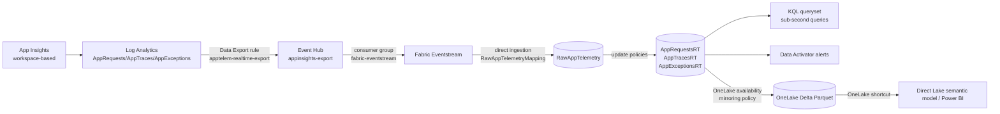

# Real-time hot path (Eventhouse, zero-ETL)

This guide adds a streaming path next to the existing batch path (notebook + pipeline).
Application Insights telemetry flows into a Fabric Eventhouse within seconds. There you can query it with KQL, raise Data Activator alerts, and mirror it to OneLake as Delta Parquet for Direct Lake reporting.

This path uses **no Spark notebooks, Data Factory pipelines, or ADLS Gen2 shortcuts**. Every hop is managed streaming or a Fabric-native policy.



## Files

| File | Purpose |
|---|---|
| [`azure/infra/modules/eventhub.bicep`](../azure/infra/modules/eventhub.bicep) | Event Hub namespace, hub `appinsights-export`, consumer group, Listen-only SAS rule `fabric-listen` |
| [`azure/infra/modules/dataexport.bicep`](../azure/infra/modules/dataexport.bicep) | Log Analytics data export rule `apptelem-realtime-export` → Event Hub |
| [`azure/infra/main.bicep`](../azure/infra/main.bicep) | Deploys both modules when `enableRealtime = true` |
| [`customers/_template.json`](../customers/_template.json) | `azure.realtime` config block |
| [`fabric/realtime/hotpath_setup.kql`](../fabric/realtime/hotpath_setup.kql) | Idempotent KQL: raw table, JSON mapping, typed tables, update policies, retention/caching, `WeatherFlowRuns()`, mirroring |
| [`azure/infra/streaming-access.bicep`](../azure/infra/streaming-access.bicep) | Separate administrator deployment: Network Contributor for the workspace identity, scoped only to the streaming VNet |
| [`scripts/Deploy-StreamingAccess.ps1`](../scripts/Deploy-StreamingAccess.ps1) | Resolves the identity and reuses an existing identical VNet assignment before deploying the bootstrap |
| [`fabric/app_telemetry_eventstream.Eventstream/`](../fabric/app_telemetry_eventstream.Eventstream/) | Exported working Extended Event Hubs source, default stream, Direct ingestion destination, and Eventstream properties; no credentials |

## Prerequisites

- **Workspace-based** Application Insights. Classic resources can't export.
- An Event Hub in the **same region** as the Log Analytics workspace, on the **Standard** SKU or higher. Basic is not supported.
- At most 10 export rules per workspace. Basic and Auxiliary log tables cannot be exported.
- A Fabric capacity with the Eventhouse `app_telemetry_eventhouse` deployed (it is part of the normal Fabric deploy).
- Rights to create Eventstream and Activator items in the Fabric workspace.
- For private Event Hub consumption, complete Step 1a before creating the Eventstream connection. The supported source is **Azure Event Hubs (Extended features mode)**; do not use the basic connector for the streaming VNet gateway.

## Step 1: Deploy the Azure resources

In `customers/<name>.json`, enable the realtime block:

```json
"realtime": {
  "enabled": true,
  "eventHubSku": "Standard",
  "eventHubCapacity": 1,
  "exportTables": ["AppRequests", "AppTraces", "AppExceptions"],
  "consumerGroup": "fabric-eventstream",
  "existingLogAnalyticsWorkspaceId": ""
}
```

If `useExistingAppInsights` is true, set `existingLogAnalyticsWorkspaceId` to the full resource ID of the workspace behind the App Insights resource. The config loader rejects the file if this is blank.

```powershell
./scripts/Deploy-Azure.ps1 -Customer <name>
```

The script returns `eventHubNamespaceName`, `eventHubName`, `eventHubConsumerGroup`, and `eventHubListenRuleName`. It does **not** output any secrets.

Verify that the export is running:

```powershell
az monitor log-analytics workspace data-export show `
  --resource-group <rg> --workspace-name <law> --name apptelem-realtime-export
```

Generate some traffic, for example with the demo API or a Power App run. Then confirm that **Incoming Messages** rises on the Event Hub's **Metrics** blade. Export latency is usually under a minute.

> The export sends batches as `{"records":[{...},{...}]}`. Each record uses the
> Log Analytics schema (`TimeGenerated`, `Type`, `Properties`, `OperationId`, ...),
> not the classic App Insights API schema (`timestamp`, `customDimensions`).

## Step 1a: Private Event Hub connectivity and streaming VNet gateway

The gateway is required for the private-network consumer path, not for the original
public-endpoint connector. The Azure deployment provisions its network prerequisites;
the gateway itself and the credential-bearing Fabric connection are created in Fabric.

1. Ensure `fabric.workspaceId` identifies an existing, capacity-assigned workspace.
   Deployment reads its workspace identity or provisions one if missing, using
   `Ensure-FabricWorkspaceIdentity.ps1`. The deploying identity must be Workspace
   Admin to provision it. The helper waits for completion and records the
   application and service-principal IDs in `out/<customer>/fabric-identity.json`.
   It does not create the workspace. No manual principal-ID copying into
   customer configuration is needed.
2. Configure `azure.realtime.privateNetworking`:

   ```json
   "privateNetworking": {
     "enabled": true,
     "location": "centralus",
     "addressPrefix": "10.50.0.0/24",
     "connectorSubnetPrefix": "10.50.0.0/27",
     "privateEndpointSubnetPrefix": "10.50.0.32/27"
   }
   ```

   `privateNetworking.location` must match the Fabric Eventstream/capacity region.
   Contoso keeps its existing Azure telemetry resources in **UK South**
   (`location: uksouth`) within `rg-apptelem-contoso`. Only the gateway VNet and
   private endpoint use **Central US**, matching the Fabric capacity. The private
   endpoint targets the existing UK South Event Hub across regions; account for
   cross-region latency and transfer charges. Existing resource names and telemetry
   endpoints are retained. The deployment script reuses the existing group without
   changing its metadata location. Do not change the top-level region to move
   existing resources: same-name resources cannot be recreated in another region.
   Choose nonoverlapping ranges for your organization's network. The config loader
   also checks subnet containment, disjointness, a /27-or-larger connector subnet,
   and avoidance of Fabric's reserved `10.240.0.0/16` and `10.224.0.0/12`.
3. Run the Azure deployment again. The deploying identity needs resource creation
   and subscription provider-registration permission
   if `Microsoft.MessagingConnectors` is not already registered. The script checks
   and registers that provider before deployment; `-WhatIf` and `-OutputsOnly`
   do not register it. The Fabric deployment stage provisions the workspace
   identity; Azure `-OutputsOnly` does not.

   This provisions:
   - A VNet with an otherwise empty `streaming-connectors` subnet delegated to
     `Microsoft.MessagingConnectors/connectors`.
   - A separate `private-endpoints` subnet and Event Hub namespace private endpoint.
   - The `privatelink.servicebus.windows.net` private DNS zone, VNet link and
     endpoint DNS zone group. Continue using the namespace's normal
     `<namespace>.servicebus.windows.net` hostname.
   - An administrator must grant the Fabric workspace identity **Network Contributor**
     on the VNet after the Fabric stage provisions the identity. The deployment
     intentionally does not create streaming Azure role assignments, so the ADO principal
     does not need `roleAssignments/write`.
   - Event Hub network rules with **default deny** and the **trusted Microsoft
     services exception enabled**. General public client traffic is denied, but
     Azure Monitor data export can still deliver events.
     Azure requires at least one allowed IP or VNet rule in selected-networks mode.
     The connector subnet has a `Microsoft.EventHub` service endpoint and is the
     only allowed subnet; there are no allowed public IP rules. Its firewall rule
     is applied after subnet creation, before deploying the data export rule.
     Private DNS still routes the configured Fabric connection through Private
     Link. The subnet allow rule additionally permits authenticated service-endpoint
     access from that subnet; this is not a private-link-only namespace.

   **This is not an all-private producer path:** Log Analytics data export needs
   the trusted-service exception on the public endpoint. Do not set public network
   access to `Disabled` for this design. The Fabric consumer uses Private Link.
   If you later set `privateNetworking.enabled = false`, deployment restores the
   Event Hub's public allow rules; incremental deployment does not delete the
   previously created network resources or role assignment.
4. Before creating the gateway, ensure the Fabric workspace identity has
   **Network Contributor** on this VNet. For Contoso, its service-principal object
   ID is `a493ff23-ef73-40a4-bbdf-7cf81df99cdb`, not application ID
   `8cae18ff-7484-4a76-9bc8-1ee2153ee06b`. Prefer the separate Bicep bootstrap:

   ```powershell
   # Use a customer administrator login with roleAssignments/write on the VNet.
   .\scripts\Ensure-FabricWorkspaceIdentity.ps1 -Customer contoso
   .\scripts\Deploy-StreamingAccess.ps1 -Customer contoso -WhatIf
   .\scripts\Deploy-StreamingAccess.ps1 -Customer contoso
   ```

   The helper checks the tenant/subscription, reads the existing workspace
   identity, and reuses an existing identical VNet role-assignment name. This
   avoids `RoleAssignmentExists` for a grant originally created in the portal.
   It does not recreate the VNet, grant subscription-wide access, or run from
   `Deploy-All.ps1`/the normal ADO stages. Contoso already has this grant; no
   additional permission is needed there.

   Portal alternative: open the VNet's
   **Access control (IAM)**, add a role assignment for **Network Contributor**, and
   select that service principal. This is a one-time administrator action.
5. In Fabric **Manage connections and gateways -> Streaming virtual network data
   gateways -> New**, choose the subscription, resource group, VNet and
   `streaming-connectors` subnet. Use the `streamingVirtualNetwork*` and
   `streamingConnectorSubnet*` values in `out/<customer>/azure-outputs.json`.
   Save the gateway, for example as `apptelem-contoso-streaming`.
6. Grant the person creating the connection **Connection Creator** or **Admin**
   on the gateway. This Fabric permission is separate from the workspace
   identity's Azure Network Contributor role.
7. In the Eventstream source wizard choose **Azure Event Hubs (Extended features
   mode)**. Create a connection with the gateway marked **[Streaming VNET]** and
   choose the resulting **[vNet]** connection. Use the Event Hub settings and
   Listen-only credentials from Step 3 below. Gateway connection testing is not
   supported by this flow; **Skip test connection** is expected. Publish the
   Eventstream and verify actual ingestion, rather than treating a saved
   connection as proof that it works.

Deployment does **not** create the streaming Fabric gateway, store its SAS
credential, or grant gateway-user permissions. These remain customer bootstrap
steps. The Eventstream topology itself is now in Git and is promoted after
the Eventhouse schema, using the customer's saved connection ID.

References: [Streaming VNet gateway creation](https://learn.microsoft.com/fabric/real-time-intelligence/event-streams/create-manage-streaming-virtual-network-data-gateways),
[streaming connector private networking prerequisites](https://learn.microsoft.com/fabric/real-time-intelligence/event-streams/streaming-connector-private-network-support-guide),
and [Log Analytics export destination networking](https://learn.microsoft.com/azure/azure-monitor/logs/logs-data-export#event-hubs).

## Step 2: Create the KQL objects

`deploy_fabric.py` appends the commands from
[`hotpath_setup.kql`](../fabric/realtime/hotpath_setup.kql) to the **staged**
KQL database's `DatabaseSchema.kql` when `azure.realtime.enabled` is true and
`KQLDatabase` is in scope. The `.execute database script` wrapper is removed
because schema publication executes the management commands itself. The source
schema and setup script are not rewritten or duplicated.

This creates the following objects before publishing the Eventstream:

- `RawAppTelemetry(records: dynamic)` plus the JSON mapping `RawAppTelemetryMapping` (`$.records`). Raw data is retained for 1 day.
- Typed tables `AppRequestsRT`, `AppTracesRT`, and `AppExceptionsRT`. Update policies (`mv-expand records`, filtered by `Type`) fill them on ingestion. They have a 30-day hot cache.
- `WeatherFlowRuns(lookback=24h)`, the streaming equivalent of the weather-flow Dataflow KQL.
- A mirroring policy (OneLake availability) on the three typed tables. See Step 5.

For manual recovery, or when using Fabric Git integration directly rather than
the deployment script, open a KQL queryset on the database and run the setup
script. If the queryset rejects `.execute database script`, run the commands
inside the `<|` block one at a time, in order. Re-running the setup preserves
existing data; it does not replay events missed before activation.

## Step 3: Create the Eventstream

Normal deployment now publishes the repository's `app_telemetry_eventstream`
after the database objects. The saved definition includes the mapping name and
data connection name required by Direct ingestion. Inspect the resulting live
source/destination status; do not create a second Eventstream for an existing
deployment.

For a new manual setup or destination recovery, use these steps:

1. **Source → Azure Event Hubs** (use **Extended features mode** and the streaming VNet gateway from Step 1a for private connectivity). Create a new connection with these settings:
   - Namespace: `eventHubNamespaceName` from Step 1. Event Hub: `appinsights-export`.
   - Authentication: Shared Access Key, using the rule `fabric-listen`. Copy the key from **Azure portal → Event Hub → Shared access policies**.
   - Consumer group: `fabric-eventstream`. Data format: **JSON**.
2. **Destination → Eventhouse**:
   - Ingestion mode: **Direct ingestion**. Workspace and database: `app_telemetry_eventhouse`.
   - Table: existing `RawAppTelemetry`. Data format: JSON. Mapping: existing `RawAppTelemetryMapping`.
3. **Publish**.
4. In **Live** mode, select the Eventhouse destination and choose **Configure**.
   Select existing table `RawAppTelemetry`, a unique data connection name, JSON
   format, and **Use existing mapping → RawAppTelemetryMapping**. Choose
   **Finish**, verify that data connection creation succeeds, and close the wizard.
   Publishing the topology alone does not complete the Direct ingestion destination.
5. Confirm that both source and destination are **Active**, then generate fresh
   telemetry. If the source starts at **Latest**, events sent before activation
   are not a reliable end-to-end test. If the inspection step has no sample data,
   generate telemetry while the source is active, refresh inspection, and select
   the existing mapping rather than creating a replacement.

### Deploying the Eventstream from ADO

The working topology was captured with the supported
[Get Eventstream Definition API](https://learn.microsoft.com/rest/api/fabric/eventstream/items/get-eventstream-definition).
Its `eventstream.json` and `eventstreamProperties.json` are preserved. The API
returned a zero logical ID in `.platform`; the repository uses the existing
Eventstream item ID as a stable, nonzero logical ID. Credentials are held in
Fabric, not in any of these files.

1. In the target tenant, create the streaming gateway and **[vNet]** Azure Event
   Hubs Extended connection from Step 1a. Enter the hub-scoped Listen-only
   `fabric-listen` SAS key directly into Fabric. Never put it in customer JSON,
   Bicep parameters, logs, or Git.
2. Set `fabric.realtime.eventHubConnectionId` to the saved connection GUID (not
   the gateway ID or source node ID). Enable `azure.realtime.enabled` and include
   `Eventhouse`, `KQLDatabase`, and `Eventstream` in `fabric.itemTypes`. The
   template leaves Eventstream out until a connection exists.
3. Run `Deploy-Fabric.ps1 -Customer <code> -Bootstrap` for a new workspace.
   Publication order is foundation/schema, Eventstream, then (normal deployment
   only) reporting. Bootstrap excludes shortcuts, semantic models, and reports,
   **not** streaming. Establish the network grant/gateway/connection before
   requesting an Eventstream publication.
4. Staging replaces both exported workspace IDs with `$workspace.$id`, the
   source connection with the customer connection ID, and destination `itemId`
   with `$items.KQLDatabase.app_telemetry_eventhouse.$id`. Despite its name,
   the working export's `itemId` references the **KQL database**, not the
   Eventhouse parent. Preserve this exported binding. The consumer group is
   read from Azure outputs rather than assumed to be `fabric-eventstream`.
5. Generate fresh telemetry and verify Step 5. Once Delta files exist, enable
   the shortcuts and run normal deployment to publish shortcuts/reporting.
   In ADO select only the required stages; leave **deployPowerPlatform=false**
   when working on telemetry infrastructure.

Contoso's non-secret connection GUID is recorded in its customer JSON. Source
IDs remain promotion anchors, not credentials. If recapturing the topology,
update the matching `SOURCE_EVENTHUB_CONNECTION_ID`,
`SOURCE_EVENTSTREAM_WORKSPACE_ID`, and `SOURCE_KQL_DATABASE_ID` constants in
`deploy_fabric.py` together. Keep node IDs and the Direct ingestion connection
name stable for the existing deployment; changing them can create a different
consumer/data connection.

Activator rules are still created manually (Step 4).

### Verified Contoso configuration and troubleshooting

On 23 October 2026 the private path was verified with real Weather Flow traffic:
`RawAppTelemetry` contained **2 batches**, `AppTracesRT` contained **11 rows**,
and the Lakehouse `dbo.AppTracesRT` shortcut displayed the same **11 rows**,
including `weather-flow.started` and `weather-flow.ended`. These are a historical
verification snapshot, not expected fixed counts. Requests/exceptions were zero
because the test produced traces.

- Workspace: `app-telem_testdeploy`; identity object ID is shown in Step 1a.
- VNet/subnet: `apptelcon-streaming-vnet` / `streaming-connectors` (Central US).
- Hub: `apptelcon-ehns-24ytcdtmvrvjg` / `appinsights-export` (UK South).
- Gateway: `[Streaming VNET] apptelcon-streaming-vnet-streaming-connectors`.
- Connection: `[vNet] apptelem-contoso-eventhub-private`.
- Source: `azure-event-hub`, Extended mode, `Latest`, `fabric-eventstream`.
- Destination label: `contoso-raw-telemetry`; the exported internal data connection
  name is `app_telemetry_eventstream_lku6ra`. Do not confuse the label with the
  internal connection name.
- Table/mapping: `RawAppTelemetry` / `RawAppTelemetryMapping`.

| Symptom | Resolution / check |
|---|---|
| `InvalidNetworkRuleSetUpdate` with empty rules and default deny | Keep the connector subnet's Event Hub service endpoint and allow rule, applied after VNet creation. Do not broadly allow public clients or disable the trusted-service producer path. |
| `roleAssignments/write` denied for ADO | Use the separate administrator bootstrap, not additional role assignments in the normal Azure deployment. |
| `InvalidServiceNameOnDelegation` | Use the full delegation `Microsoft.MessagingConnectors/connectors`. |
| Source permission/connector validation error | Confirm the workspace **object ID** has VNet-scoped Network Contributor. Allow RBAC propagation, then activate the individual source again. Verify Runtime logs report connector/task `RUNNING`. |
| Source Active but no events | Generate fresh traffic after activation; inspect source incoming/outgoing counts and connector errors. `Latest` does not prove historical data will be replayed. |
| Destination published but not configured / no mapping shown | Open Configure in Live mode. Wait for a real sample, choose JSON and existing `RawAppTelemetryMapping`, Finish, verify successful data connection creation. |
| Raw rows present but no typed rows | Inspect `records`, `Type`, and update policies; workspace export field names differ from the classic App Insights API. Check ingestion failures before changing mappings. |
| Traces present but Requests shortcut empty | Check `AppTracesRT`; Weather Flow emits traces, not necessarily request/exception records. |
| Typed rows present but shortcut empty | Verify mirroring policy/status and wait for the first Delta export (target latency 5 minutes). Mirroring does not backfill data predating policy activation. |

Verify the actual data rather than just an Active status:

```kusto
RawAppTelemetry | count
AppTracesRT | count
WeatherFlowRuns(1h)
.show ingestion failures | where FailedOn > ago(1h)
.show table AppTracesRT policy update
.show table AppTracesRT operations mirroring-status
```

Run each query/command separately. Finally open the Lakehouse's `dbo.AppTracesRT`
shortcut and inspect actual rows; `Requests` and `RequestsCustomDimensions` are
separate batch notebook tables and are not the streaming verification target.

Use direct ingestion with the KQL mapping, not Eventstream's "event processing before ingestion". This keeps all the nested-JSON shaping in update policies inside the database, so there is one source of truth and nothing to re-map in the UI.

Verify:

```kusto
RawAppTelemetry | count
AppRequestsRT | where TimeGenerated > ago(10m) | take 10
```

## Step 4: Query and alert

Example sub-second queries:

```kusto
AppRequestsRT
| where TimeGenerated > ago(15m)
| summarize requests = count(), failures = countif(Success == false),
            p95ms = percentile(DurationMs, 95) by bin(TimeGenerated, 1m), Name

WeatherFlowRuns(1h)
| where isnull(endTime) or durationMs > 60000
```

**Data Activator** (Activator item): use the queryset or Eventstream as the source.

- *Failed requests*: in the queryset, run `AppRequestsRT | where TimeGenerated > ago(5m) | summarize failures = countif(Success == false)`. Choose **Set alert** and set the condition to `failures > 0`. Use Email or Teams as the action.
- *Long or never-ended weather-flow runs*: run `WeatherFlowRuns(1h) | where isnull(endTime) and startTime < ago(10m) or durationMs > 60000`. Alert when the row count is greater than 0, with an object per `clientRunId`.

Set the alert check frequency (for example 1–5 min). Each check is a KQL query against the Eventhouse.

## Step 5: Enable OneLake availability

You can enable it either way:

- **UI**: open the KQL database and turn on **OneLake availability**. This applies to new tables. To cover existing tables, toggle it per table.
- **KQL**: the setup script already runs this command:

  ```kusto
  .alter-merge table AppRequestsRT policy mirroring dataformat=parquet
      with (IsEnabled=true, TargetLatencyInMinutes=5)
  ```

Monitor:

```kusto
.show table AppRequestsRT policy mirroring
.show table AppRequestsRT operations mirroring-status
```

Caveats:

- **No backfill**: only data ingested *after* you enable mirroring is written to OneLake. Enable it before you rely on the reports.
- **Latency vs. file size**: without `TargetLatencyInMinutes`, files can take up to about 3 hours (or about 200–256 MB) to appear. A low target latency produces more, smaller files.
- **Schema changes are restricted** while mirroring is on. Disable mirroring, alter the table, and re-enable it.
- The raw table is not mirrored on purpose. It holds only 1 day of data and is not report-friendly.

## Step 6: Direct Lake reporting

1. Create OneLake shortcuts in the Lakehouse `app_telemtry_lh_bronze` that point to the three `*RT` tables. These are internal OneLake shortcuts, **not** ADLS Gen2 shortcuts. They are zero-copy, and they read the mirrored Delta files, so OneLake availability (Step 5) is required. You can create them either way:
   - **Automated (ADO)**: set `fabric.realtime.lakehouseShortcuts.enabled = true`, and include `AppRequestsRT` in `tables`. `deploy_fabric.py` writes `shortcuts.metadata.json` into the *staged* Lakehouse copy under `Tables/dbo`, matching the schema-enabled Lakehouse and model. The target KQL database is resolved through `$items.KQLDatabase.app_telemetry_eventhouse.$id`. Shortcut publication failures stop deployment; they are not ignored. The source `shortcuts.metadata.json` stays `[]`.
   - **Manual**: in the Lakehouse, select **Tables → New shortcut → Microsoft OneLake**, then pick the KQL database and the tables.

   The target tables and their mirrored Delta files must already exist, so the first deployment takes two passes:
   1. Run ADO with **fabricBootstrap = true**, or run `Deploy-Fabric.ps1 -Customer <name> -Bootstrap` (for `Deploy-All.ps1`, use `-FabricBootstrap`). This explicitly omits shortcuts, semantic models, and reports, regardless of the shortcut setting. It publishes infrastructure only; it does not run notebooks or pipelines.
   2. Run `hotpath_setup.kql`, configure/publish the Eventstream, and generate telemetry. Wait for mirroring and verify that `AppRequestsRT` appears in the KQL database's OneLake view with Delta files. An empty Lakehouse or a provisioned SQL endpoint alone is not sufficient.
   3. Set `fabric.realtime.lakehouseShortcuts.enabled = true` with `AppRequestsRT` in `tables`, then rerun ADO with **fabricBootstrap = false** (or omit `-Bootstrap`). The script finishes the infrastructure/shortcut pass before publishing semantic models and reports. The deploying identity needs access to the KQL database's OneLake data as well as the Lakehouse.

   Shortcuts show data only after the first mirrored files are written, which can take up to `TargetLatencyInMinutes`.
2. The checked-in `app_telemetry_model` now reads `dbo.AppRequestsRT` through the Lakehouse shortcut, **not** the notebook's `Requests` table. Its model table is still named `Requests`, and supported report-facing column names and lineage tags are retained:

   | Model column | Hot-path source column |
   |---|---|
   | `timestamp`, `id`, `name`, `url` | `TimeGenerated`, `Id`, `Name`, `Url` |
   | `success`, `resultCode`, `duration` | `Success` (boolean), `ResultCode`, `DurationMs` (milliseconds) |
   | `customDimensions` | `Properties` (mirrored dynamic value as a string) |
   | `operation_Name`, `operation_Id` | `OperationName`, `OperationId` |
   | `cloud_RoleName`, `client_CountryOrRegion` | `AppRoleName`, `ClientCountryOrRegion` |
   | `itemCount`, `_ResourceId` | `ItemCount`, `_ResourceId` |

   Legacy-only columns such as `source`, `performanceBucket`, `customMeasurements`, session/user IDs, and other client fields are removed rather than fabricated. Existing reports using those columns, or expecting string-valued `success`, need updating. Add traces/exception model tables separately when required; the current model reports requests only.

Direct Lake reads the mirrored Delta files directly, so no import refresh or ETL step is needed.

## Cost and operations notes

- **Event Hub**: Standard SKU, 1 throughput unit (TU) = 1 MB/s or 1,000 events/s ingress. Raise `eventHubCapacity` or enable auto-inflate for bursts.
- **Log Analytics data export** is billed per GB exported.
- **Eventhouse**: the capacity cost is driven by always-on compute. Keep the raw-table retention short, which is already set to 1 day.
- To add more tables (for example `AppDependencies`), add them to `exportTables`. Then add a typed table, expand function, and update policy in `hotpath_setup.kql`, and enable mirroring on the new table.
- The batch ingestion artifacts (notebook + pipeline -> Lakehouse `Requests`) are unchanged and optional. The checked-in semantic model no longer depends on them; do not run them to bootstrap this hot path.

## Not yet verified

These configs have not been run end to end. In particular, check the following:

- That the queryset accepts `.execute database script`.
- That the export-record column names (for example `DurationMs`, `Success`, `Properties`) match your workspace. Inspect them with `RawAppTelemetry | take 1`.
- That Eventstream's direct-ingestion mode accepts the existing mapping.
- The end-to-end Eventstream deployment, shortcut resolution and model import in the target tenant. Bootstrap creates the KQL database before the reporting deployment.
- That `dbo.AppRequestsRT` resolves through the generated OneLake shortcut and exposes the mirrored Delta schema to Direct Lake. Inspect the Lakehouse shortcut and model after the first reporting deployment.
