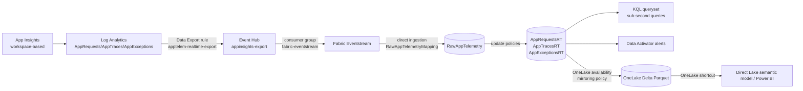

# Real-time hot path (Eventhouse, zero-ETL)

This guide adds a streaming path next to the existing batch path (notebook + pipeline).
Application Insights telemetry flows into a Fabric Eventhouse within seconds. There you can query it with KQL, raise Data Activator alerts, and mirror it to OneLake as Delta Parquet for Direct Lake reporting.

This path uses **no Spark notebooks, Data Factory pipelines, or ADLS Gen2 shortcuts**. Every hop is managed streaming or a Fabric-native policy.



## Files

| File | Purpose |
|---|---|
| [`azure/infra/modules/eventhub.bicep`](../azure/infra/modules/eventhub.bicep) | Event Hub namespace, hub `appinsights-export`, consumer group, Listen-only SAS rule `fabric-listen` |
| [`azure/infra/modules/dataexport.bicep`](../azure/infra/modules/dataexport.bicep) | Log Analytics data export rule `apptelem-realtime-export` → Event Hub |
| [`azure/infra/main.bicep`](../azure/infra/main.bicep) | Deploys both modules when `enableRealtime = true` |
| [`customers/_template.json`](../customers/_template.json) | `azure.realtime` config block |
| [`fabric/realtime/hotpath_setup.kql`](../fabric/realtime/hotpath_setup.kql) | Idempotent KQL: raw table, JSON mapping, typed tables, update policies, retention/caching, `WeatherFlowRuns()`, mirroring |

## Prerequisites

- **Workspace-based** Application Insights. Classic resources can't export.
- An Event Hub in the **same region** as the Log Analytics workspace, on the **Standard** SKU or higher. Basic is not supported.
- At most 10 export rules per workspace. Basic and Auxiliary log tables cannot be exported.
- A Fabric capacity with the Eventhouse `app_telemetry_eventhouse` deployed (it is part of the normal Fabric deploy).
- Rights to create Eventstream and Activator items in the Fabric workspace.

## Step 1: Deploy the Azure resources

In `customers/<name>.json`, enable the realtime block:

```json
"realtime": {
  "enabled": true,
  "eventHubSku": "Standard",
  "eventHubCapacity": 1,
  "exportTables": ["AppRequests", "AppTraces", "AppExceptions"],
  "consumerGroup": "fabric-eventstream",
  "existingLogAnalyticsWorkspaceId": ""
}
```

If `useExistingAppInsights` is true, set `existingLogAnalyticsWorkspaceId` to the full resource ID of the workspace behind the App Insights resource. The config loader rejects the file if this is blank.

```powershell
./scripts/Deploy-Azure.ps1 -Customer <name>
```

The script returns `eventHubNamespaceName`, `eventHubName`, `eventHubConsumerGroup`, and `eventHubListenRuleName`. It does **not** output any secrets.

Verify that the export is running:

```powershell
az monitor log-analytics workspace data-export show `
  --resource-group <rg> --workspace-name <law> --name apptelem-realtime-export
```

Generate some traffic, for example with the demo API or a Power App run. Then confirm that **Incoming Messages** rises on the Event Hub's **Metrics** blade. Export latency is usually under a minute.

> The export sends batches as `{"records":[{...},{...}]}`. Each record uses the
> Log Analytics schema (`TimeGenerated`, `Type`, `Properties`, `OperationId`, ...),
> not the classic App Insights API schema (`timestamp`, `customDimensions`).

## Step 2: Create the KQL objects

Open a KQL queryset on the Eventhouse database. Paste [`hotpath_setup.kql`](../fabric/realtime/hotpath_setup.kql) and run it. It is idempotent and creates the following objects:

- `RawAppTelemetry(records: dynamic)` plus the JSON mapping `RawAppTelemetryMapping` (`$.records`). Raw data is retained for 1 day.
- Typed tables `AppRequestsRT`, `AppTracesRT`, and `AppExceptionsRT`. Update policies (`mv-expand records`, filtered by `Type`) fill them on ingestion. They have a 30-day hot cache.
- `WeatherFlowRuns(lookback=24h)`, the streaming equivalent of the weather-flow Dataflow KQL.
- A mirroring policy (OneLake availability) on the three typed tables. See Step 5.

If the queryset rejects `.execute database script`, run the commands inside the `<|` block one at a time, in order.

## Step 3: Create the Eventstream

In the Fabric workspace, select **New item → Eventstream**, for example `app_telemetry_es`.

1. **Source → Azure Event Hubs**. Create a new connection with these settings:
   - Namespace: `eventHubNamespaceName` from Step 1. Event Hub: `appinsights-export`.
   - Authentication: Shared Access Key, using the rule `fabric-listen`. Copy the key from **Azure portal → Event Hub → Shared access policies**.
   - Consumer group: `fabric-eventstream`. Data format: **JSON**.
2. **Destination → Eventhouse**:
   - Ingestion mode: **Direct ingestion**. Workspace and database: `app_telemetry_eventhouse`.
   - Table: existing `RawAppTelemetry`. Data format: JSON. Mapping: existing `RawAppTelemetryMapping`.
3. **Publish**.

### Deploying the Eventstream from ADO

Build the Eventstream once in the **dev** workspace, then let `Deploy-Fabric.ps1` promote it:

1. Create the Eventstream in dev as described above, then commit it to Git through Fabric Git integration. This produces `fabric/<name>.Eventstream/` with `eventstream.json`.
2. In `scripts/deploy_fabric.py`, set these constants from that `eventstream.json`:
   - `SOURCE_EVENTHUB_CONNECTION_ID`
   - `SOURCE_EVENTHOUSE_ID`
   - `SOURCE_KQL_DATABASE_ID`
   
   At deploy time these values are replaced: the connection ID with the customer value, and the Eventhouse and KQL database IDs with `$items.Eventhouse/KQLDatabase.<name>.$id`.
3. In the **target** tenant, create a Fabric cloud connection of type Azure Event Hubs (Shared Access Key, rule `fabric-listen`). Put its ID in `fabric.realtime.eventHubConnectionId` in the customer JSON. Connections hold credentials, so they cannot be created from Git.
4. Keep `"Eventstream"` in `fabric.itemTypes`. `Get-CustomerConfig.ps1` refuses to deploy an Eventstream without a valid connection ID.

Activator rules are still created manually (Step 4).

Use direct ingestion with the KQL mapping, not Eventstream's "event processing before ingestion". This keeps all the nested-JSON shaping in update policies inside the database, so there is one source of truth and nothing to re-map in the UI.

Verify:

```kusto
RawAppTelemetry | count
AppRequestsRT | where TimeGenerated > ago(10m) | take 10
```

## Step 4: Query and alert

Example sub-second queries:

```kusto
AppRequestsRT
| where TimeGenerated > ago(15m)
| summarize requests = count(), failures = countif(Success == false),
            p95ms = percentile(DurationMs, 95) by bin(TimeGenerated, 1m), Name

WeatherFlowRuns(1h)
| where isnull(endTime) or durationMs > 60000
```

**Data Activator** (Activator item): use the queryset or Eventstream as the source.

- *Failed requests*: in the queryset, run `AppRequestsRT | where TimeGenerated > ago(5m) | summarize failures = countif(Success == false)`. Choose **Set alert** and set the condition to `failures > 0`. Use Email or Teams as the action.
- *Long or never-ended weather-flow runs*: run `WeatherFlowRuns(1h) | where isnull(endTime) and startTime < ago(10m) or durationMs > 60000`. Alert when the row count is greater than 0, with an object per `clientRunId`.

Set the alert check frequency (for example 1–5 min). Each check is a KQL query against the Eventhouse.

## Step 5: Enable OneLake availability

You can enable it either way:

- **UI**: open the KQL database and turn on **OneLake availability**. This applies to new tables. To cover existing tables, toggle it per table.
- **KQL**: the setup script already runs this command:

  ```kusto
  .alter-merge table AppRequestsRT policy mirroring dataformat=parquet
      with (IsEnabled=true, TargetLatencyInMinutes=5)
  ```

Monitor:

```kusto
.show table AppRequestsRT policy mirroring
.show table AppRequestsRT operations mirroring-status
```

Caveats:

- **No backfill**: only data ingested *after* you enable mirroring is written to OneLake. Enable it before you rely on the reports.
- **Latency vs. file size**: without `TargetLatencyInMinutes`, files can take up to about 3 hours (or about 200–256 MB) to appear. A low target latency produces more, smaller files.
- **Schema changes are restricted** while mirroring is on. Disable mirroring, alter the table, and re-enable it.
- The raw table is not mirrored on purpose. It holds only 1 day of data and is not report-friendly.

## Step 6: Direct Lake reporting

1. Create OneLake shortcuts in the Lakehouse `app_telemtry_lh_bronze` that point to the three `*RT` tables. These are internal OneLake shortcuts, **not** ADLS Gen2 shortcuts. They are zero-copy, and they read the mirrored Delta files, so OneLake availability (Step 5) is required. You can create them either way:
   - **Automated (ADO)**: set `fabric.realtime.lakehouseShortcuts.enabled = true`, and optionally edit `tables`. `deploy_fabric.py` then writes `shortcuts.metadata.json` into the *staged* Lakehouse copy. The target KQL database is resolved through `$items.KQLDatabase.app_telemetry_eventhouse.$id`. The script also turns on fabric-cicd's `enable_shortcut_publish` and `continue_on_shortcut_failure` flags. The source `shortcuts.metadata.json` stays `[]`.
   - **Manual**: in the Lakehouse, select **Tables → New shortcut → Microsoft OneLake**, then pick the KQL database and the tables.

   The target tables must already exist, so the first deployment takes two passes:
   1. Deploy with shortcuts disabled.
   2. Run `hotpath_setup.kql`.
   3. Enable shortcuts and redeploy.

   Shortcuts show data only after the first mirrored files are written, which can take up to `TargetLatencyInMinutes`.
2. Build a Direct Lake semantic model over those shortcut tables, or add them to `app_telemetry_model`. Then build Power BI reports on top.

Direct Lake reads the mirrored Delta files directly, so no import refresh or ETL step is needed.

## Cost and operations notes

- **Event Hub**: Standard SKU, 1 throughput unit (TU) = 1 MB/s or 1,000 events/s ingress. Raise `eventHubCapacity` or enable auto-inflate for bursts.
- **Log Analytics data export** is billed per GB exported.
- **Eventhouse**: the capacity cost is driven by always-on compute. Keep the raw-table retention short, which is already set to 1 day.
- To add more tables (for example `AppDependencies`), add them to `exportTables`. Then add a typed table, expand function, and update policy in `hotpath_setup.kql`, and enable mirroring on the new table.
- The batch path (notebook + pipeline → Lakehouse `Requests`) is unchanged. You can run both paths, or retire the batch path once the hot path has been validated.

## Not yet verified

These configs have not been run end to end. In particular, check the following:

- That the queryset accepts `.execute database script`.
- That the export-record column names (for example `DurationMs`, `Success`, `Properties`) match your workspace. Inspect them with `RawAppTelemetry | take 1`.
- That Eventstream's direct-ingestion mode accepts the existing mapping.
- That the installed fabric-cicd version publishes `Eventstream` items, and that `$items.KQLDatabase...$id` resolves for items created in the same run. If it doesn't, rerun the deploy.
- That the generated `shortcuts.metadata.json` shape (OneLake target `workspaceId`/`itemId`/`path`) matches what fabric-cicd and the Lakehouse expect. Compare it with a Git-synced Lakehouse that has a manually created shortcut.
